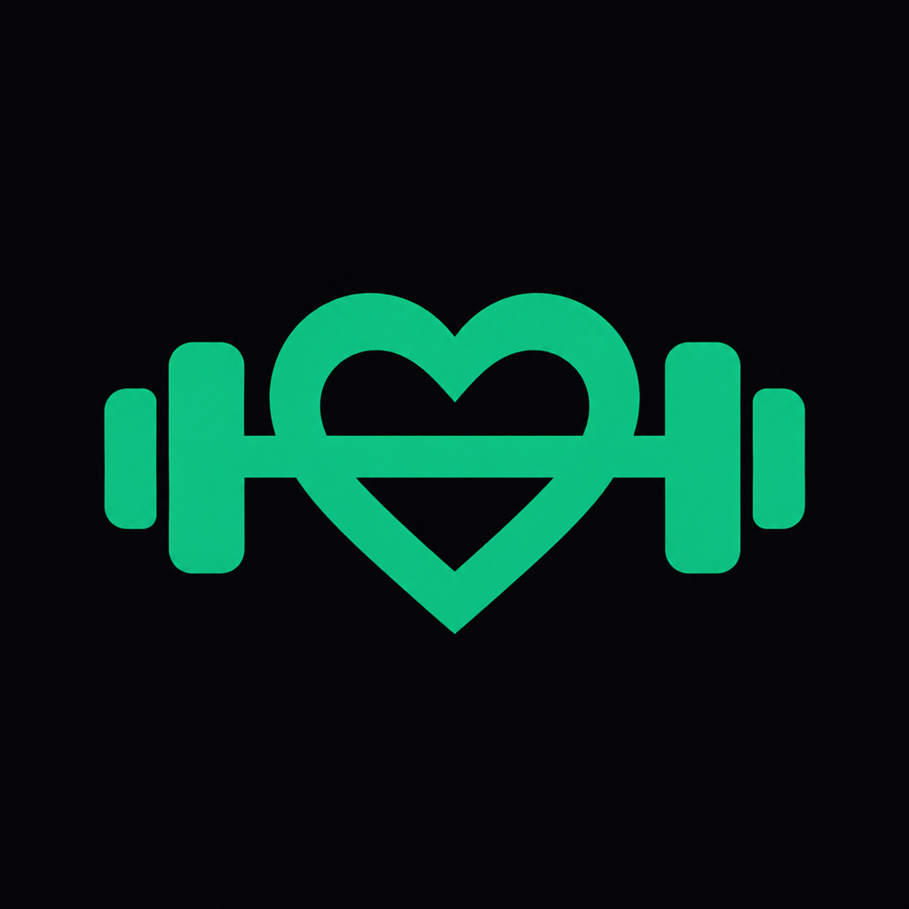

<div align="center">



# GymCrush

**Train together. Remember every setting. Celebrate every PR.**

A real-time, two-person gym tracker built for iOS and Android — designed around shared sessions, visual machine setups, live partner progress, and zero-friction logging on the gym floor.

[](https://expo.dev)
[](https://reactnative.dev)
[](https://www.typescriptlang.org)
[](https://supabase.com)

</div>

---

## Why GymCrush?

Most workout trackers are built for solo lifters. When two partners train together — often across Android and iOS, alternating on the same machines or working side-by-side on different stations — spreadsheets and solo apps get in the way.

GymCrush keeps **both partners in sync without getting in the way**:

- **The app takes the color of whoever is lifting.** One partner owns signature blue, the other owns signature orange. Switch active lifters in one tap when sharing a machine, and every button, check, and ring shifts color so a set never goes to the wrong profile.
- **Built for sweaty hands on a bench.** Large 56 pt/dp steppers, tabular rounded numerals, one-tap set completion, and an automatic rest timer with a built-in barbell/sled plate calculator.
- **Native feel on both phones.** Follows Apple Human Interface Guidelines (iOS 26+ Liquid Glass floating bars & sheets, SF Symbols, Dynamic Type) and Material 3 (48 dp touch targets, edge-to-edge layout, ripple feedback).

---

## Key Features

### Visual Machine Catalog
- **Snap & Save Equipment**: Photograph the exact machines at your gym and organize them by muscle group (`Chest`, `Back`, `Legs`, `Glutes`, `Shoulders`, `Arms`, `Core`, `Full Body`) and floor location.
- **Per-Partner Dial & Pin Settings**: Save 1 to 5 custom adjustments per machine for each partner (e.g., *Seat Height 5 / Back Pad 3* vs. *Seat Height 2 / Narrow Grip*). Never guess or re-measure between sets.
- **Full Machine & Exercise Editing**: Rename machines (with optional Traditional Chinese labels), update photos, switch muscle groups/workout types, and refine partner setups anytime.

### Live Buddy Workouts & Partner Progress
- **Real-Time Shared Clock**: Start a workout on either phone and both devices share the session timer, live set feed, and rest countdowns over Supabase Realtime.
- **Dedicated Partner Tab**: Switch to your partner's tab right inside an active workout to see every exercise and set they have completed, what station they are currently on, and their live break timer — strictly read-only so you never accidentally edit their log.
- **1-Tap Hype & Automatic PRs**: Personal records trigger instant celebration alerts across both phones, and you can send quick reactions (`🔥`, `💪`, `❤️`, `👑`, `👀`, `💧`) or custom messages anytime.
- **Gym-Time Reminder**: Optional configurable count-up session alarm (with OS notifications) so you never lose track of time at pay-by-the-hour gyms.

### Smart Timing, Rest & Plate Math
- **Automatic Rest & Plate Calculator**: Completing a set starts a 90-second rest countdown with `−15s`, `+15s`, and `Skip` controls, plus an expandable per-side plate calculator for barbells and plate-loaded sleds.
- **Phone-Clock Session & Exercise Timing**: Tracks start and end timestamps for workouts, exercises, and individual sets — surfacing workout start times in history, average time per set, break durations, and transition time between exercises.

### Complete History & Flexible Editing
- **DuoRings Weekly Streak**: Concentric dual-colored rings track each partner's weekly workout goal and advance your shared couple streak together.
- **Progress Charts**: Compare heaviest weight and max reps over time per machine for either partner.
- **Post-Workout Editing**: Rename sessions, edit or remove sets, and add or remove exercises in saved workouts — handy whenever one partner forgets their phone and logs sets afterward.

### Offline-First & Bilingual
- **Offline Queue & Auto-Sync**: Log sets without gym Wi-Fi; local state persists in `AsyncStorage` and durable sync events flush automatically to Supabase once reconnected.
- **Bilingual UI (`EN` / `繁體中文`)**: Instant toggle between English and Traditional Chinese, including machine names, locations, and muscle labels.

---

## Tech Stack

| Layer | Technology |
| --- | --- |
| **Framework** | Expo SDK 58 · React Native 0.88 · Expo Router |
| **Language** | TypeScript (strict mode) |
| **Backend & Sync** | Supabase (Anonymous Auth, Postgres with RLS, Realtime Broadcast/Channels, Private Storage) |
| **Local Persistence** | `@react-native-async-storage/async-storage` + offline outbox |
| **Native UI & Media** | `expo-symbols`, `expo-glass-effect`, `expo-haptics`, `expo-image-picker`, `expo-image-manipulator`, `expo-notifications`, `react-native-svg` |

---

## Getting Started

### 1. Install Dependencies

```sh
npm install
```

### 2. Configure Environment (for Live Sync)

Copy `.env.example` to `.env` and add your Supabase project URL and publishable anon key:

```sh
cp .env.example .env
```

```env
EXPO_PUBLIC_SUPABASE_URL=https://YOUR_PROJECT.supabase.co
EXPO_PUBLIC_SUPABASE_ANON_KEY=YOUR_PUBLISHABLE_KEY
```

Apply the SQL migrations in `supabase/migrations/` in order inside your Supabase SQL Editor and enable **Anonymous Sign-Ins** under **Authentication → Sign In / Providers**. See [docs/INSTALL.md](docs/INSTALL.md) for the full backend and device-pairing walkthrough.

### 3. Run Locally

```sh
# Start Metro dev server
npm start

# Run on Android device / emulator
npm run android

# Run on iOS simulator / device
npm run ios

# Standalone Release build for iOS device (no Metro required)
npm run ios:release

# Standalone Release build for Android device
npx expo run:android --device --variant release
```

---

## Verification & Testing

```sh
# TypeScript type checking
npm run typecheck

# Unit & integration test suite (Store, Sync Engine, Timing, Plate Math, Navigation Contracts)
npm test
```

For full physical-device testing, EAS build setup, and seven-day iOS Personal Team signing instructions, see [docs/INSTALL.md](docs/INSTALL.md). For design tokens and UI architecture rules, see [docs/DESIGN.md](docs/DESIGN.md).

---

## Project Structure

```text
app/                    Expo Router screens & bottom sheets
├── (tabs)/             Tab bar routes: Today, Machines, History, Couple
├── workout.tsx         Active workout & partner progress tabs
├── partner-workout.tsx Standalone read-only partner live view
├── workout-summary.tsx Post-session recap & PR celebration
├── new-machine.tsx     Create machine with photo & partner settings
├── add-exercise.tsx    Exercise picker sheet
├── machine-settings/   Full machine & adjustment editor sheet
├── edit-set/           Set editor sheet
├── routine.tsx         Quick routine builder
├── profile.tsx         Partner names, units (kg/lbs), weekly goals
└── onboarding.tsx      First-run setup wizard

src/
├── components/         Shared bars, banners, image & tab components
├── features/           Domain modules (workout, machines, history, today, couple, onboarding)
├── i18n/               English & Traditional Chinese copy
├── services/           Supabase cloud sync, realtime engine, notifications, photos, history
├── store/              Global reactive store with AsyncStorage persistence
├── theme/              Light/dark color tokens, typography, spacing & touch targets
├── types/              Core TypeScript domain models
└── ui/                 HIG & Material 3 UI primitives, keyboard helpers, DuoRings
```

---

## License

Private repository — all rights reserved.
